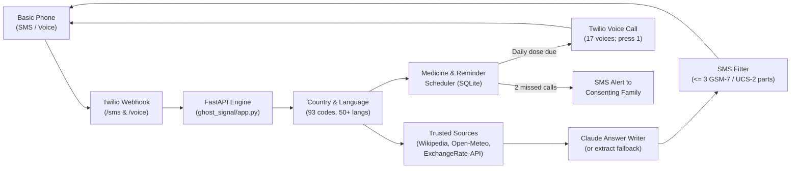

# 👻 Ghost Signal

> **Grandma's old button phone just got an AI. Daily medicine calls in her own language, family alerts if she misses a dose, and sourced SMS answers — no smartphone, no app, no data plan.**

[](https://github.com/Dan16ssd/ghost-signal/actions/workflows/tests.yml)
[](https://kiroween.devpost.com/)
[](docs/kiro-journal.md)


[](LICENSE)

**Ghost Signal** resurrects the basic button phone — plain SMS and ordinary voice calls — as an AI medication and daily-life companion for older adults living alone, built for **Kiroween 2026** (**Resurrection** category). It works on **any GSM phone** (no smartphone, app install, or mobile data plan) and includes an **in-browser old-phone simulator** on the web. It understands **50+ languages** (17 with spoken phone voices) across **93 countries**, inferring local time zone, currency, and language hints directly from the caller's phone number.

### Try it in 60 seconds (no phone or Twilio account needed)

Run the built-in old-phone simulator locally (same answer engine, same reminder & medicine-call scheduler, with browser speech for ringing calls):

```bash
pip install -r requirements.txt
cp .env.example .env        # set GHOST_CONTACT (repo URL or email for Wikipedia); API keys optional
uvicorn ghost_signal.app:app --reload
```

Open `http://127.0.0.1:8000` and try any command below — or text `HELP` once connected to a Twilio number:

| Message | What happens |
|---|---|
| `MEDS 8am 8pm blood pressure pill` | **The phone rings every day** at 8am and 8pm local time: *"It is time for your medicine. Press 1 when you have taken it."* |
| `MEDS FAMILY +8562055512345` | Adds a family contact (activated after they reply `YES`); if 2 calls go unanswered, they receive an SMS alert |
| `MEDS LIST` / `MEDS DEL 1` / `1` | List active medicines, remove one, or confirm a dose by SMS |
| `MEDS LANG en` | Change the language of the medicine calls |
| `ຢາ 8am ຢາຄວາມດັນ` (Lao) / `MEDS 9am pastilla` (Spanish) / `MEDS 8am दवा` (Hindi) | Schedules the daily call in that language |
| `What is dengue fever?` | 1–3 SMS sourced answer + Wikipedia link + *"see a health worker"* |
| `WEATHER Vientiane` | Current weather + tomorrow's forecast (Open-Meteo) |
| `RATE` / `ອັດຕາ USD` | Exchange rate in the sender's local currency (LAK, PHP, NGN, INR, etc.) |
| `ໄຂ້ຍຸງລາຍ ແມ່ນຫຍັງ` / `Paano bumaba ang presyon ng dugo?` / `डेंगू के लक्षण क्या हैं?` | Sourced answer in Lao, Tagalog, Swahili, Hindi, Arabic, and 50+ languages |
| `REMIND 8pm take medicine` | One-off SMS reminder at 8pm **in the sender's own time zone** |
| `REMIND in 2 hours call mum` / `REMIND LIST` / `REMIND DEL 1` | Schedule, list, or delete reminders |
| `STOP` / `START` | Immediate opt-out (cancels reminders & medicine calls) / opt back in |
| `HELP` | Short command guide fitting in 2 SMS parts |

## The problem

In hospital wards, one of the most common preventable reasons older patients deteriorate is simple: they live alone, forget regular doses of blood-pressure, diabetes, or heart medication, and no one notices until complications bring them back to the clinic. Most still rely on basic button phones — big keys, multi-day battery, nothing to update — while modern health apps, chatbots, and voice assistants require smartphones and mobile data. Their children often live in another city or abroad with no simple way to know a daily dose was missed.

Ghost Signal meets them on the device already in their pocket. A basic phone can already do the two things that matter most: **ring** and **receive a text**.

## What it does

1. **Rings every day for each medication (`MEDS`):** A patient or family member texts the schedule once (e.g., `MEDS 8am 8pm blood pressure pill`). At each local time, Ghost Signal places an ordinary voice call in the person's own language saying which medicine to take and asking them to press `1`.
2. **Retries and alerts family on missed doses (`MEDS FAMILY`):** If the first call goes unanswered, Ghost Signal calls again 10 minutes later. If both calls go unanswered, it texts a consenting family member (who opted in by replying `YES`). Only the person's own number is ever called.
3. **Answers health and daily questions by plain SMS:** Users can ask about symptoms, medications, weather (`WEATHER`), or currency rates (`RATE`) in 50+ languages. Every reply is grounded strictly in trusted public sources, fits in at most 3 SMS segments, and appends *"see a health worker"* for health topics.
4. **Picks the call language automatically:** the language the person writes in wins (`ຢາ 8am ...` = Lao, `pastilla` = Spanish); if the text shows none (`MEDS 8am losartan`), the phone's country decides (+856 Laos = Lao, +91 India = Hindi); `MEDS LANG <code>` overrides it.
5. **Sends local-time SMS reminders (`REMIND`):** Schedules one-off reminders using the time zone inferred from the sender's country calling code.
6. **Simulates the full old-phone experience in the browser:** The web simulator at `/` lets judges test multi-tap keypad entry, country switching, RTL Arabic, ringing medicine calls spoken aloud, and family-alert previews without needing a SIM card.

## How it works



| Task | Where it runs | Why |
|---|---|---|
| Country, time zone & currency detection | `ghost_signal/countries.py` | Sender's calling code (`+856`, `+63`, `+91`, `+254`, ...) sets local time zone, currency, and language tie-breakers automatically |
| Language detection & fixed replies | `ghost_signal/lang.py` | Detects script (Lao, Arabic, Devanagari, Cyrillic, Han, ...) or Latin-script words; hand-written replies in English, Lao, and Arabic; other languages load from translation files written once in Kiro (`ghost_signal/data/`), else English. Single-word commands (`YES`, `HELP`, `1`) reply in the country's language |
| Daily medicine calls & escalation | `ghost_signal/meds.py` + `app.py` | Schedules local-time doses in SQLite, calls via Twilio `<Say>` (17 voices; Lao speakers hear Thai, which most Lao understand; unvoiced languages fall back to SMS), retries after 10 min, alerts consenting family after 2 missed calls |
| Sourced Q&A, weather & exchange rates | `ghost_signal/sources.py` + `answer.py` | Searches local-language Wikipedia first (falling back to English Wikipedia while replying in the user's language), Open-Meteo, and ExchangeRate-API; refuses to guess if sources don't answer |
| SMS segment & encoding enforcement | `ghost_signal/sms.py` | Enforces `<= 3` SMS parts across GSM-7 (153 chars/part) and UCS-2 (67 chars/part for Lao/Arabic/etc.), verified by property-based tests |
| Opt-out, dedupe & cost guards | `ghost_signal/store.py` | `STOP` always wins and cancels reminders/calls; deduplicates Twilio `MessageSid` retries; caps at 20 questions/hour per sender and daily AI/call budgets; masks phone numbers in logs and never stores message text |

## How we used Kiro

Ghost Signal's requirements, design and rules live in Kiro specs and steering. New features are built by Kiro's agent from those specs (starting with `offline-languages`), and Kiro hooks, custom agents and our own MCP server check the work:

| Kiro feature | Where | What it does |
|---|---|---|
| **Specs (7)** | `.kiro/specs/` | `ghost-signal`, `sms-gateway`, `reminders`, `medication-calls`, `phone-simulator`, `mcp-server`, `offline-languages` — EARS requirements, design, and task checklists |
| **Steering (6)** | `.kiro/steering/` | Always-on `product`, `tech`, `structure` plus file-scoped `sms-rules`, `languages`, and `design` steering docs |
| **Hooks (4)** | `.kiro/hooks/` | `tests-on-save`, `secret-and-number-scan`, `help-and-readme-sync`, and `language-review` for Lao/Arabic fixed messages |
| **Custom agents (2)** | `.kiro/agents/` | `language-reviewer` (checks Lao/Arabic phrasing and SMS length) and `gateway-auditor` (audits `STOP`, signatures, dedupe, cost caps, privacy) |
| **MCP server** | `.kiro/settings/mcp.json` | Ghost Signal exposes itself as a 5-tool MCP server (`ask`, `check_sms`, `detect_language`, `wikipedia_search`, `fixed_messages`) so Kiro tests real multilingual SMS replies without a phone |
| **Property-based tests** | `tests/` (Hypothesis) | Verifies SMS segment limits for arbitrary Unicode (caught a lone UTF-16 surrogate crash) and reminder/dose scheduling across 4 time zones (caught a New York spring DST bug) |

Read the full build log in [`docs/kiro-journal.md`](docs/kiro-journal.md).

## Features

- **Daily medicine reminder calls** in 17 spoken languages (hand-written call scripts in English, Arabic, Spanish, French, Portuguese, Hindi, Tagalog, and Thai; the other voiced languages are being written once in Kiro by the `offline-languages` spec; SMS fallback for unvoiced languages)
- **Runs with no paid AI key:** medicine calls, reminders, weather, rates and STOP/START need no AI; with no `ANTHROPIC_API_KEY`, answers use plain source extracts
- **Two-strike family escalation** with explicit `YES` opt-in so caregivers only get alerted when two calls go unanswered
- **Zero-guesswork SMS answers** sourced strictly from Wikipedia, Open-Meteo, and ExchangeRate-API with source links and health-worker reminders
- **50+ languages and 93 countries** detected automatically from message text and phone calling code
- **Production SMS safeguards:** `STOP`/`START` compliance, Twilio webhook signature check, `MessageSid` deduplication, per-sender hourly rate limits, global daily AI & voice call caps, and masked phone numbers in logs
- **Old-phone web simulator + MCP server** for instant local testing and agent-driven verification

## Project structure

```text
ghost-signal/
├── ghost_signal/
│   ├── app.py            FastAPI server, Twilio SMS/Voice webhooks, background scheduler
│   ├── answer.py         Command router, grounded Claude Q&A, extract fallback
│   ├── meds.py           Daily medicine schedules, 17 Twilio voices, hand-written call scripts
│   ├── reminders.py      Time-zone-aware reminder parsing & scheduling
│   ├── sms.py            GSM-7 / UCS-2 encoding and <=3 segment fitter
│   ├── countries.py      93 country calling codes -> time zone, currency, language hint
│   ├── lang.py           50+ language detection and fixed messages
│   ├── sources.py        Wikipedia, Open-Meteo weather, ExchangeRate-API clients
│   ├── store.py          SQLite state (opt-outs, dedupe, rate limits, reminders, doses)
│   ├── twilio_sms.py     Twilio SMS, Voice calls, and request signature verification
│   ├── mcp_server.py     FastMCP server (5 tools for Kiro / MCP clients)
│   ├── data/             Translations written once in Kiro (call scripts, messages), loaded at startup
│   └── static/index.html Interactive old-phone simulator (multi-tap keypad + browser speech)
├── .kiro/                Specs (7), steering (6), hooks (4), custom agents (2), MCP config
├── tests/                Unit + Hypothesis property-based tests (no network required)
├── docs/kiro-journal.md  Honest Kiro build journal
├── Dockerfile            Container build for production
└── render.yaml           One-click Render Blueprint
```

## Run it yourself

**Requirements:** Python 3.11+ (tested on 3.11–3.13). No API keys are needed. Without `ANTHROPIC_API_KEY` the app runs in no-AI mode: medicine calls, reminders, weather and rates work fully; questions get plain source extracts.

### Local development & tests

```bash
pip install -r requirements.txt
cp .env.example .env        # fill in GHOST_CONTACT (required by Wikipedia); keys optional
uvicorn ghost_signal.app:app --reload
# Open http://127.0.0.1:8000 for the old-phone simulator

python -m pytest -q                 # run unit + property-based tests (offline)
python -m ghost_signal.mcp_server   # run Ghost Signal as a stdio MCP server
```

### Deploy on Render

`Dockerfile` and `render.yaml` target Render's free tier: create a **Blueprint** from this repository, then set `PUBLIC_BASE_URL` (and the three `TWILIO_*` values for real calls) in the Render dashboard. `ANTHROPIC_API_KEY` is optional.

On the free tier the service sleeps when idle (keep the simulator page open while demoing; it polls every 15 s) and its SQLite file resets on restart. For real daily use, choose a paid instance and mount a disk at `/data` with `GHOST_DB=/data/ghost_signal.db`.

### Connect Twilio (real SMS + Voice calls)

A **free Twilio trial** (no credit card) is enough for a demo: it includes one trial number and free voice minutes and SMS, but only calls and texts **verified numbers** (up to 5) and plays a short trial message before each call.

1. Get an **SMS- and Voice-capable** trial number in the Twilio console, and verify the phones you will use (Phone Numbers > Verified Caller IDs). For calls outside the US, enable the country under Voice > Geo permissions.
2. Set `TWILIO_ACCOUNT_SID`, `TWILIO_AUTH_TOKEN`, `TWILIO_FROM_NUMBER`, and `PUBLIC_BASE_URL` in `.env` (or your host's environment).
3. In the Twilio number settings, set **A message comes in** to `POST https://<your-host>/sms`.
4. Outbound medicine calls fetch TwiML from `https://<your-host>/voice/dose/<id>` (requires `PUBLIC_BASE_URL`).

## Limitations and Next

**Honest limitations today:**
- Twilio has no Lao text-to-speech voice, so Lao speakers hear Thai (mutually intelligible for most Lao speakers); languages outside the 17 supported voices receive an SMS medicine reminder instead of a phone call.
- State is stored in a single SQLite file (`GHOST_DB`), which fits a single-instance deployment with a mounted disk rather than multi-replica horizontal scaling.
- Health answers currently pull from Wikipedia rather than a dedicated clinical reference; every health answer appends *"see a health worker"* and is informational only, not medical advice.
- Real SMS and voice delivery require a configured Twilio number and public HTTPS URL; without them, the web simulator demonstrates the full workflow locally. On a Twilio trial, only verified numbers can be called or texted, so judges should use the simulator.

**Next:**
- Add WHO / vetted public-health sources alongside Wikipedia for health queries.
- Native speaker review of Lao, Arabic, and Tagalog phrasing with the `language-reviewer` Kiro agent.
- Add real-device demo video and screenshots of Kiro specs, hooks, and MCP runs.

## License

Licensed under the **MIT License**. See [LICENSE](LICENSE).
